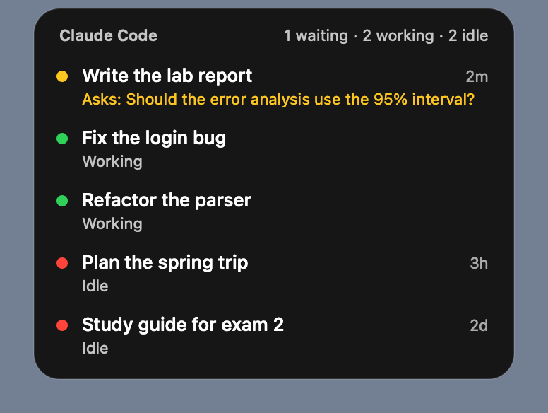

# Stoplight

A traffic light for Claude Code in your Mac's menu bar. One dot tells you what your Claude Code chats are doing. Hover it and it expands into a list of every chat.



- **Green**: Claude is working.
- **Yellow**: a chat is waiting on you. Claude asked you a question, has a plan for you to review, or needs your input.
- **Red**: nothing is happening.

## Features

- The dot shows the most urgent state across all your chats: yellow first, then green, then red.
- Hover the dot to see each chat's name and status, the question it's asking you, and how long ago its status changed.
- Click a chat to jump to it in the Claude desktop app.
- Click the dot to keep the card open. Right-click it for Open at Login and Quit.
- Hold ⌘ and drag the dot to move it, for example right next to the notch.
- Read-only: it reads files Claude Code already writes on your Mac. No hooks, no settings changes, no network.

## How it works

Claude Code keeps a small status file for each running chat in `~/.claude/sessions/`, with the chat's name and whether it's busy, waiting or idle. Stoplight reads those once a second. It also reads the end of each chat's transcript in `~/.claude/projects/` to see whether the last turn asked you something: a question in the desktop app's next-step box, a question card, or a plan waiting for approval. A message that just ends in "?" doesn't count.

Limits:

- Those files are Claude Code internals, not a public API, so a Claude Code update can break Stoplight.
- A permission prompt in the desktop app can show as green, because Claude Code doesn't record it in those files.
- A question older than 12 hours counts as idle, so one old chat doesn't keep the dot yellow forever.
- Clicking opens chats from the Claude desktop app. Chats running in a terminal are listed but can't be opened from Stoplight.

Stoplight is a personal project and isn't affiliated with Anthropic.

## Install

Stoplight is free and isn't notarized by Apple (that needs a paid developer account). If you download it in a browser, macOS blocks it the first time you open it. Installing from Terminal avoids that warning.

### Option 1: Terminal (no warning)

Paste this into Terminal. It downloads the latest release into Applications and opens it:

```bash
curl -fsSL https://github.com/aneeshkaravadi/claude-stoplight/releases/latest/download/Stoplight.zip -o "$TMPDIR/Stoplight.zip" && ditto -x -k "$TMPDIR/Stoplight.zip" /Applications && open /Applications/Stoplight.app
```

macOS only quarantines files downloaded by apps like Safari and Chrome, so this copy opens normally. Run the same command again later to update (quit Stoplight first).

### Option 2: Download the zip

1. Download **Stoplight.zip** from the [latest release](https://github.com/aneeshkaravadi/claude-stoplight/releases/latest).
2. Unzip it and drag **Stoplight.app** into your Applications folder.
3. Open it. macOS says it can't verify the app. Close the warning without picking Move to Trash, then go to **System Settings → Privacy & Security**, scroll down to the message about Stoplight, and click **Open Anyway**. You only need to do this once.

There's no Dock icon; the dot appears in the menu bar. Runs on macOS 14 or later, on Apple silicon and Intel Macs.

## Build from source

You need the Command Line Tools (`xcode-select --install`). Xcode is not needed: the app is a single Objective-C file built with `clang`.

```bash
git clone https://github.com/aneeshkaravadi/claude-stoplight.git
cd claude-stoplight
./build.sh install
```

`./build.sh` on its own builds `build/Stoplight.app`. With `install` it also copies the app to `~/Applications` and launches it.

## Options

- `--demo` shows made-up chats instead of your real ones.
- `--snapshot out.png` opens the card, saves a picture of it, and quits. Add `--demo` to picture the made-up chats.
- `--login on`, `--login off` or `--login status` sets Open at Login from Terminal, for example `/Applications/Stoplight.app/Contents/MacOS/Stoplight --login on`.

## License

[MIT](LICENSE)
